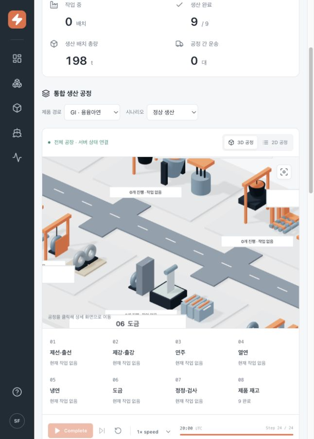
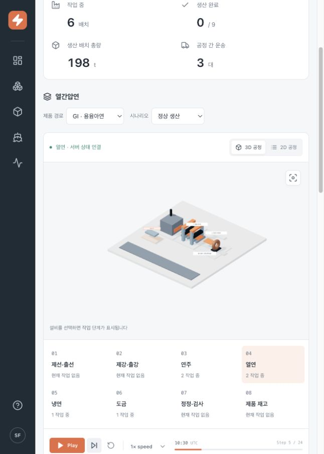

# 생산 공장의 가동감 점검 — 2026-10-24

대상: 현재 인앱 브라우저의 `http://127.0.0.1:4173/?workspace=production`.
사용자 목표: 오버뷰와 각 공정 상세에서 소재가 실제 작업을 거쳐 이동하는 모습을 이해할 수 있어야 한다.
이번 작업은 화면 관찰과 코드 확인이다. 제품 소스는 변경하지 않았고 테스트를 다시 실행하지 않았다.

## 1. 현재 오버뷰 — 공장 구조와 가동 상태의 전달 부족

진입 당시 GI 필터, NORMAL, tick24, 9/9 완료, 운송0 상태였다. 따라서 이 캡처에서 멈춰 있는 것 자체를 오류로 판단하지 않는다. 좁은 인앱 패널에서 공장 일부가 잘려 보이고, 개별 설비가 같은 크기의 독립된 전시 공간처럼 배치되어 있다. 공정 사이 생산 동선과 투입·배출 지점이 잘 드러나지 않는다. 공정 선택 목록은 명확하지만 장면만으로 작업을 읽기 어렵다.

## 2. 열연 상세 — 작업 중 상태와 공간 동작의 연결 부족

로컬 합성 시뮬레이션을 Reset하고 열연을 선택한 뒤 Step5까지 진행했다. 열연 작업 중 2배치라는 상태가 표시되지만 상세 설비는 캔버스 중앙의 작은 모형으로 보이고 넓은 여백이 남는다. 동일 소재가 설비에 들어가 가공되고 배출되는 공간적 흐름을 확인할 수 없다. 캡처 당시에는 일시정지 상태이므로 정지 이미지 자체로 재생 중 움직임을 판단하지 않는다.

## 코드로 확인한 원인

- `src/production/scene/Equipment.tsx`: 설비는 공정·구역·상세 여부만 받고 실행 중 작업과 시간은 받지 않는다. 롤러와 크레인은 정적이다.
- `src/production/scene/ProductionScene.tsx`: 실제 선택 가능한 배치와 설비 내부의 장식용 소재가 별도 위치에 배치된다. 상세에서도 소재가 설비를 통과하지 않는다.
- `src/production/scene/Transport.tsx`: 운송 중 차량 이동은 있지만 적재·하역·설비 인계·빈 차 복귀 단계는 없다.
- `backend/app/production.py`, `backend/app/main.py`: 대부분의 작업과 공정 간 운송이 한 tick이며 기본 재생은 tick당 실제 1초이다. 가공을 관찰하기 전에 상태가 바뀌기 쉽다.

## 제안할 재작업 기준

공통 공간 표현을 먼저 정하고, 열연에서 하나의 소재 ID를 입고부터 출고까지 연결해 기준 장면을 완성한다. 제안 흐름은 입고 차량 → 하역·대기 → 가열로 장입·추출 → 롤러 이송·압연 → 냉각·권취 → 출고 대기·적재이다. 설비의 동작은 백엔드 작업 상태와 연결하고 가동·대기·고장 장면을 구분한다. 상세에서는 작업 라인이 화면을 채우게 하고 오버뷰는 그 상태를 축약해 보여준다. 이후 제선·제강·연주·냉연·도금·정정에 각 공정 고유의 동작과 공간을 적용한다.

이 흐름은 다음 구현을 위한 제안이며 특정 제철소의 실측 설비 배치나 검증된 조업 모델이 아니다. 업무 시간과 관찰 가능한 재생 속도는 분리하고, 시각 효과만으로 생산 완료를 결정하지 않는다.

## 접근성과 확인 한계

현재 공정 선택과 운송 표는 텍스트 경로를 제공한다. 상세 모형·설비 라벨이 작아서 식별과 포인터 선택이 어려울 위험이 있으며, 개선 후에도 같은 선택을 2D 목록과 키보드에서 제공해야 한다. 움직임을 줄이는 설정에서도 작업 상태가 전달되어야 한다. 이번 점검으로 전체 접근성 준수, 모든 화면 크기, 실제 제철 공정 정확성 또는 연속 재생의 프레임 성능을 검증했다고 주장하지 않는다.

증거는 이번 점검 중 직접 촬영하고 저장된 파일을 다시 열어 확인했다. 브라우저는 NORMAL/tick5/일시정지, GI 필터, 열연 상세에 남겨 두었다.
